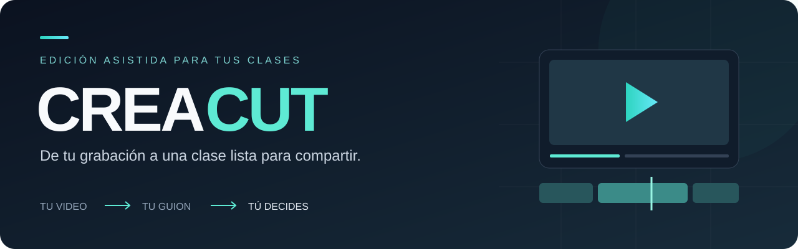

  

  <a href="#downloads"><strong>Downloads</strong></a> ·
  <a href="#info-de-la-app">Info de la app</a> ·
  <a href="#guía-del-usuario">Guía del usuario</a> ·
  <a href="docs/README.md">Documentación</a>

CREACUT convierte un video y un guion en una propuesta de edición que puedes
revisar, corregir y exportar. **CREACUT propone; tú decides.**

## Downloads

**Beta 0.2** · Elige el instalador para tu equipo.

| Sistema | Descarga directa | Instalación |
|---|---|---|
| Windows x64 | [↓ ZIP](https://github.com/CREA-Ingenieria/CREAcut-editing-pipeline/releases/download/v0.2.0-beta.1/CREAcut-Beta-0.2-Windows-x64.zip) | [Guía Windows](electron-editor/docs/INSTALADOR_WINDOWS.md) |
| macOS · Apple Silicon | [↓ DMG arm64](https://github.com/CREA-Ingenieria/CREAcut-editing-pipeline/releases/download/v0.2.0-beta.1/CREAcut-Beta-0.2-arm64.dmg) | [Guía macOS](electron-editor/docs/INSTALADOR_MACOS.md) |

> **Pendiente de publicación:** los enlaces funcionarán cuando el equipo publique
> los archivos de la beta. Cada instalador debe comprobarse en su sistema.

Windows descarga un `.zip` con el instalador; al instalar prepara Python, PyTorch,
FFmpeg, Whisper y Gemma 4 desde sus orígenes, y ofrece el paquete CUDA si detecta
una GPU NVIDIA. En macOS, la primera vez que abres la app CREAcut prepara Python, PyTorch,
FFmpeg y Whisper desde sus orígenes; Gemma se prepara con Ollama. [Modelos y requisitos →](docs/modelos.md)

## Info de la app

- **Edición asistida:** transcribe la grabación y propone tomas según el guion.
- **Revisión a tu ritmo:** compara, ajusta cortes y guarda el proyecto.
- **Diapositivas y presentador:** incorpora PDF, PowerPoint o imágenes.
- **Exportación a MP4:** conserva el original y reutiliza las decisiones guardadas.

[Conocer el editor →](docs/GUIA_USUARIO.md) · [Diapositivas y efectos →](docs/VISOR_Y_PRESENTADOR.md)

## Guía del usuario

**Instala → prepara los modelos → importa video y guion → revisa → guarda y exporta.**

[Primer proyecto](docs/GUIA_USUARIO.md) · [Modelos de IA](docs/modelos.md) ·
[Configuración](docs/configuration.md) · [Todas las guías](docs/README.md)

## Desarrollo

Python procesa el video; Electron y React presentan el editor.

[Preparar el entorno](docs/installation.md) · [Comandos](COMANDOS.md) ·
[Arquitectura](docs/ARQUITECTURA.md) · [Construir y publicar](docs/publicacion.md)

## Equipo

**Ángel Peñaranda:** frontend, desarrollo web e interfaz Electron. 

**Sebastián Suárez:** idea y dirección del proyecto; pipeline, transcripción, procesamiento y render.

## Licencia

CREAcut es software libre: puedes usarlo, estudiarlo, modificarlo y
redistribuirlo bajo la [GNU General Public License v3.0 o posterior](LICENSE).
Si distribuyes una versión modificada, debe mantener esta misma licencia y
conservar los avisos de autoría.

© 2026 Universidad de los Andes — CREA Lab. [Autoría](AUTHORS.md) ·
[Componentes de terceros](THIRD_PARTY_NOTICES.md).
